# Programowanie w CUDA na NVIDIA GPU (PKG) – sprawozdanie z projektu

**Przedmiot:** Przetwarzanie równoległe – Programowanie w CUDA na NVIDIA GPU (PKG), rok akad. 2026/2027, studia niestacjonarne
**Projekt:** Suma elementów kwadratowego okna (2R+1)×(2R+1) tablicy N×N – warianty dostępu do pamięci globalnej i współdzielonej

**Autorzy:**
- Mateusz Chlebosz, 151817
- Wojciech Durczak, 161609

**Data oddania:** TODO

---

## Spis treści

1. Opis systemów użytych w eksperymencie
2. Zakres zrealizowanego zadania
3. Realizacja projektu (kod CPU, konfiguracja uruchomienia, warianty kerneli, analiza dostępów do pamięci)
4. Wyniki pomiarów (N_stab, porównanie CPU/GPU, energia, potwierdzenie profilerem)
5. Wnioski

Wszystkie listingi, rysunki i tabele są numerowane. Rysunki znajdują się w katalogu `images/`, surowe wyniki w `results/`,
kod w plikach `common.h`, `cpu_ref.h`, `kernels.cuh`, `stencil.cu`.

---

## 1. Opis systemów użytych w eksperymencie

Eksperymenty wykonano na dwóch systemach: maszynie laboratoryjnej `gpu1` (host `gpu-6`, dostęp przez `polluks`) z kartą
GTX 1080 oraz na laptopie Lenovo Legion Slim 5 14 z kartą RTX 4060 Laptop. Program CPU był uruchamiany na procesorze
tego samego systemu, w którym znajduje się dana karta.

### 1.1. Procesory (CPU)

**Tabela 1.** Procesory użyte do obliczeń referencyjnych (OpenMP).

| | System 1 (laboratorium) | System 2 (laptop) |
|---|---|---|
| model | Intel Core i7-8700 (Coffee Lake) | AMD Ryzen 7 7840HS (Zen 4) |
| rdzenie / wątki | 6 / 12 (rdzenie jednorodne, SMT 2) | 8 / 16 (rdzenie jednorodne, SMT 2) |
| zegar | 3,2 GHz bazowy, do 4,6 GHz | 3,8 GHz bazowy, do 5,1 GHz |
| pamięć podręczna L3 | 12 MB | 16 MB |
| rozszerzenia wektorowe użyte w kodzie | AVX2 + FMA (`-march=native`) | AVX2 (`/arch:AVX2`) |
| maks. liczba jednocześnie wykonywanych wątków | 12 | 16 |
| moc nominalna (TDP) | **65 W** – Intel ARK | **35–54 W** (cTDP) – AMD; do obliczeń przyjęto **54 W** |
| system / kompilator | Ubuntu 24.04, gcc 13.3 (`-O3 -fopenmp -march=native`) | Windows 11, MSVC 19.44 (`/O2 /openmp /arch:AVX2`) |

Obydwa procesory mają jednorodną architekturę (bez podziału na rdzenie wydajne i energooszczędne).

### 1.2. Karty graficzne (GPU)

Parametry w tabeli 2 odczytano funkcją `cudaGetDeviceProperties` / `cudaDeviceGetAttribute` na obu kartach
(oraz `nvidia-smi`), parametry katalogowe – ze specyfikacji NVIDIA.

**Tabela 2.** Karty graficzne i ograniczenia wynikające z Compute Capability (CC).

| | GTX 1080 (laboratorium, GPU 0) | RTX 4060 Laptop |
|---|---|---|
| układ / architektura | GP104 / Pascal | AD107 / Ada Lovelace |
| Compute Capability | **6.1** | **8.9** |
| liczba SM × rdzenie CUDA/SM | 20 × 128 = 2560 | 24 × 128 = 3072 |
| zegar SM podczas pomiarów | ~1830 MHz (maks. 1911 MHz) | ~2475 MHz (maks. 3105 MHz) |
| pamięć globalna | 8 GB GDDR5X, szyna 256 bit, 320 GB/s | 8 GB GDDR6, szyna 128 bit, 256 GB/s |
| pamięć podręczna L2 | 2 MB | 32 MB |
| moc znamionowa | **180 W** (Graphics Card Power, NVIDIA; limit w `nvidia-smi` 180 W) | TGP **35–115 W** (NVIDIA); w tym laptopie maks. limit **105 W** (`nvidia-smi -q -d POWER`) |
| CUDA (kompilacja / sterownik) | CUDA 12.9, `-arch=sm_61` / sterownik 580.196 | CUDA 13.5, `sm_89` / sterownik 621.14 |
| maks. wątków w bloku | 1024 | 1024 |
| maks. wątków na SM | **2048** | **1536** |
| maks. bloków na SM | 32 | 24 |
| pamięć współdzielona na blok | **48 KB** (bez możliwości zwiększenia) | 48 KB (opt-in do 99 KB – nieużywane) |
| pamięć współdzielona na SM | 96 KB | 100 KB (wspólna 128 KB z L1) |
| banki pamięci współdzielonej | 32 banki × 4 B | 32 banki × 4 B |
| rejestry na SM / na blok | 64 K / 64 K (32-bit) | 64 K / 64 K (32-bit) |
| rozmiar warpa | 32 | 32 |
| buforowanie odczytów globalnych | L2; zunifikowana pamięć L1/tekstur buforuje tylko dane tylko-do-odczytu (ścieżka `__ldg`) | L1 + L2 (L1 i pamięć współdzielona to ta sama struktura 128 KB) |

Ograniczenia istotne dla projektu:
- **48 KB pamięci współdzielonej na blok** (GTX 1080 nie pozwala na więcej). Kafel bloku ma (BS+2R)² liczb float, więc
  dla BS=32 wariant 1 mieści się do R=39, a wariant 2 (z dopełnieniem wiersza) do R=38. Ten sam limit stosujemy na obu
  kartach, aby kod był identyczny.
- **Liczba wątków na SM**: blok 32×32 = 1024 wątki, więc na GTX 1080 mieszczą się 2 bloki na SM, a na RTX 4060 tylko 1
  (1536/1024). Dla BS=16 (256 wątków) liczbę bloków na SM ogranicza zwykle pamięć współdzielona.
- **32 banki po 4 B** – słowo o indeksie `a` leży w banku `a % 32`; odczyty różnych słów z tego samego banku przez wątki
  jednego warpa są obsługiwane sekwencyjnie (konflikt banków).

---

## 2. Zakres zrealizowanego zadania

Zrealizowano wszystkie elementy wymagane w opisie projektu:

1. **Program CPU (OpenMP)** – równoległy program referencyjny liczący tablicę OUT dla tych samych danych co GPU.
2. **Dwa warianty kernela GPU** (oraz pomocniczy kernel kontrolny bez pamięci współdzielonej):
   - **wariant 1** – łączone (coalesced) odczyty z pamięci globalnej i odczyty z pamięci współdzielonej bez konfliktów banków,
   - **wariant 2** – niełączone odczyty z pamięci globalnej i odczyty z pamięci współdzielonej z konfliktami banków;
   w obu wariantach kafel jest ładowany do pamięci współdzielonej kolektywnie przez wszystkie wątki bloku.
3. **Bloki wątków 16×16 i 32×32**, siatka liczona z wymiarów tablicy wynikowej, z obsługą wymiarów niepodzielnych przez BS.
4. **Test poprawności** – porównanie element po elemencie wyników GPU z CPU dla danych niejednorodnych (losowych) i
   jednorodnych, z tolerancją błędu zmiennoprzecinkowego; dodatkowo `compute-sanitizer` (memcheck, racecheck).
5. **Eksperyment obliczeniowy** na dwóch kartach (GTX 1080, RTX 4060 Laptop):
   - wyznaczenie **N_stab** dla wariantu 1, BS=32, **R1 = 8 < BS** i **R2 = 36 > BS** (N = 128…16384),
   - porównanie CPU, wariantu 1 i wariantu 2 dla BS ∈ {16, 32}, R ∈ {8, 36}, N ∈ {4096, 8192} (N ≥ max N_stab = 768).
6. **Miary**: czas (mediana 10 pomiarów), wydajność [GFLOP/s], szacunkowa energia (moc nominalna × czas), teoretyczny CGMA;
   liczba transakcji pamięci i konfliktów banków potwierdzona profilerem Nsight Compute.

Wybór parametrów:
- **R1 = 8 i R2 = 36** – jedna wartość mniejsza, a druga większa od BS=32 (wymaganie). R=36 jest blisko górnej granicy
  wynikającej z 48 KB pamięci współdzielonej (kafel 104×104 = 43 KB). Dla R=8 narzut „ramki” kafla (halo) jest duży
  w stosunku do liczby obliczeń (CGMA 58–89), dla R=36 obliczenia dominują (CGMA 171–461), więc oba przypadki pokazują
  różne proporcje pracy na pamięci i obliczeń.
- **N = 4096 i 8192** – wyraźnie powyżej N_stab obu kart (≤ 768), a jednocześnie czas CPU dla R=36 nie przekracza kilku sekund.

Najważniejsze wyniki: wariant 1 osiąga 0,7–1,1 TFLOP/s (4–6× szybciej niż wielordzeniowy CPU), wariant 2 jest 7–22×
wolniejszy od wariantu 1 i we wszystkich konfiguracjach wolniejszy nawet od CPU. Spowolnienie wariantu 2 jest prawie w całości wyjaśnione
konfliktami banków pamięci współdzielonej (rozdz. 5).

---

## 3. Realizacja projektu

### 3.1. Struktura programu i dane wejściowe

Program `stencil` (plik `stencil.cu` + nagłówki) w jednym uruchomieniu: generuje tablicę TAB (N×N, float), liczy wynik na
CPU, kopiuje TAB do pamięci globalnej GPU (`cudaMalloc`, `cudaMemcpy`), uruchamia wybrane kernele, kopiuje wynik i
porównuje go z CPU. Parametry: `-N= -R= -BS= -mode=cpu,gpu1,gpu2 -reps= -data=random|uniform`.

Dane niejednorodne generuje deterministyczny generator xorshift32 (wartości z przedziału [0,1), stałe ziarno) – te same
dane na Windows i Linux. Tablica wynikowa ma wymiar M×M, M = N − 2R.

### 3.2. Program referencyjny CPU (OpenMP)

**Listing 1.** Równoległe obliczenie tablicy OUT na CPU (`cpu_ref.h`).

```cpp
static constexpr int JB = 64;

static void stencilCPU(const float *__restrict tab, float *__restrict out, int N, int R) {
    const int M = N - 2 * R;
    const int K = 2 * R + 1;
#pragma omp parallel for schedule(dynamic, 4)
    for (int i = 0; i < M; ++i) {                    // wiersz wyniku – praca jednego wątku
        float *o = out + (size_t)i * M;
        for (int jb = 0; jb < M; jb += JB) {         // fragment 64 kolejnych wyników
            float acc[JB];                           // zmienna prywatna wątku (rejestry SIMD)
            for (int k = 0; k < JB; ++k) acc[k] = 0.0f;
            if (jb + JB <= M) {
                for (int u = 0; u < K; ++u) {
                    const float *row = tab + (size_t)(i + u) * N + jb;
                    for (int v = 0; v < K; ++v)
                        for (int k = 0; k < JB; ++k) acc[k] += row[v + k];   // wektoryzowane (AVX2)
                }
                for (int k = 0; k < JB; ++k) o[jb + k] = acc[k];
            } else { /* końcówka wiersza – ta sama pętla dla n = M - jb elementów */ }
        }
    }
}
```

- **Podział pracy**: dyrektywa `#pragma omp parallel for` dzieli wiersze tablicy wynikowej między wątki. Użyto
  `schedule(dynamic, 4)` (wątki pobierają po 4 wiersze): przy `schedule(static)` na Windows co kilka uruchomień system
  umieszczał dwa wątki na jednym rdzeniu i cały pomiar był 2× wolniejszy (pozostałe wątki czekały na najwolniejszy);
  podział dynamiczny wyrównuje obciążenie i usunął ten efekt.
- **Zmienne**: `tab`, `out`, `N`, `R`, `M`, `K` są współdzielone (tylko do odczytu; każdy wątek zapisuje rozłączne wiersze
  `out`), `i`, `jb`, `u`, `v`, `k`, `o`, `row` i tablica `acc[64]` są prywatne (stos wątku, w praktyce rejestry YMM –
  8 rejestrów × 8 floatów).
- **Lokalność**: przestrzenna – pętla wewnętrzna czyta kolejne adresy wiersza (`row[v+k]`), co pozwala na wektoryzację;
  czasowa – wiersze `tab[i..i+2R]` są używane wielokrotnie (dla każdego `v` i przez sąsiednie wiersze wyniku) i pozostają
  w L1/L2, a akumulatory w rejestrach nie wymagają zapisów do pamięci w pętli wewnętrznej.
- **Kolejność sumowania** pojedynczego elementu (u zewnętrzne, v wewnętrzne) jest taka sama jak na GPU.
- **Pomiar**: `omp_get_wtime()` wokół wywołania funkcji, po rozgrzewce trwającej ≥ 1 s (rozdz. 3.7).

### 3.3. Konfiguracja uruchomienia kernela

Wątek `(tx, ty)` bloku `(bx, by)` liczy jeden element wyniku `OUT[i0+ty][j0+tx]`, gdzie `i0 = by·BS`, `j0 = bx·BS`.

**Listing 2.** Wyznaczenie konfiguracji uruchomienia (`stencil.cu`, funkcja `makeCfgBS`).

```cpp
const int M = N - 2 * R;                                   // wymiar tablicy wynikowej
const int T = BS + 2 * R;                                  // wymiar kafla TAB potrzebnego blokowi
c.block = dim3(BS, BS);                                    // 256 lub 1024 wątki
c.grid  = dim3((M + BS - 1) / BS, (M + BS - 1) / BS);      // ceil(M/BS) x ceil(M/BS) bloków
c.smem  = (size_t)T * c.pitch * sizeof(float);             // dynamiczna pamięć współdzielona: T wierszy po P słów
kernel<<<c.grid, c.block, c.smem>>>(d_in, d_out, N, R);    // parametry: adres TAB, adres OUT, N, R
```

- Liczba bloków w każdym wymiarze to ⌈M/BS⌉, więc siatka pokrywa całą tablicę wynikową także gdy M nie jest
  wielokrotnością BS; wątki z `i ≥ M` lub `j ≥ M` nie zapisują wyniku, a elementy kafla spoza TAB (`gr ≥ N` lub `gc ≥ N`)
  są ładowane jako 0 (nie wpływają na żadny zapisywany wynik).
- Rozmiar pamięci współdzielonej zależy od R, dlatego jest dynamiczny (`extern __shared__`, trzeci parametr `<<< >>>`).
  `P` (pitch) to długość wiersza kafla w pamięci współdzielonej – równa T lub dopełniona (rozdz. 3.4, 3.5).
- Przykład: N=8192, R=36, BS=32 → M=8120, siatka 254×254 bloków, kafel 104×104, 43 264 B pamięci współdzielonej.
- Kernele są szablonami `template<int BS>` – rozmiar bloku jest stałą kompilacji (łatwiejsze indeksowanie), N i R są
  parametrami wywołania.

**Tabela 3.** Parametry kafla dla konfiguracji użytych w eksperymentach.

| BS | R | T = BS+2R | wariant 1: P / pamięć współdz. | wariant 2: P / pamięć współdz. | bloki na SM (GTX 1080 / RTX 4060), wariant 1 |
|---:|---:|---:|---|---|---|
| 16 | 8  | 32  | 48 / 6 144 B   | 32 / 4 096 B   | 8 / 6 (limit wątków) |
| 16 | 36 | 88  | 112 / 39 424 B | 96 / 33 792 B  | 2 / 2 (limit pamięci współdz.) |
| 32 | 8  | 48  | 48 / 9 216 B   | 64 / 12 288 B  | 2 / 1 (limit wątków) |
| 32 | 36 | 104 | 104 / 43 264 B | 112 / 46 592 B | 2 / 1 (limit wątków) |

### 3.4. Wariant 1 – dostęp efektywny

**Listing 3.** Kernel wariantu 1 (`kernels.cuh`).

```cpp
__host__ __device__ constexpr int pitchV1(int BS, int T) { return BS == 32 ? T : padTo(T, 16); }

template <int BS>
__global__ void stencilKernelV1(const float *__restrict__ in, float *__restrict__ out, int N, int R) {
    extern __shared__ float tile[];                      // kafel T x T (wiersze po P słów)
    const int T = BS + 2 * R;
    const int P = pitchV1(BS, T);
    const int tx = threadIdx.x, ty = threadIdx.y;
    const int i0 = blockIdx.y * BS, j0 = blockIdx.x * BS;

    // (a) kolektywne ładowanie kafla – wszystkie BS*BS wątków, krok BS*BS
    for (int idx = ty * BS + tx; idx < T * T; idx += BS * BS) {
        const int r = idx / T, c = idx - r * T;          // kolejne idx -> kolejne kolumny wiersza
        const int gr = i0 + r, gc = j0 + c;
        tile[r * P + c] = (gr < N && gc < N) ? in[(size_t)gr * N + gc] : 0.0f;
    }
    __syncthreads();                                     // kafel kompletny przed obliczeniami

    // (b) obliczenia z pamięci współdzielonej
    const int M = N - 2 * R, K = 2 * R + 1;
    const int i = i0 + ty, j = j0 + tx;
    if (i < M && j < M) {
        const float *base = tile + ty * P + tx;
        float s = 0.0f;                                  // akumulator w rejestrze
        for (int u = 0; u < K; ++u)
            for (int v = 0; v < K; ++v) s += base[u * P + v];
        out[(size_t)i * M + j] = s;
    }
}
```

**Organizacja zmiennych:**
- `in`, `out` – wskaźniki do pamięci globalnej (parametry kernela, pamięć stała parametrów);
- `tile` – pamięć współdzielona bloku (`extern __shared__`), widoczna dla wszystkich wątków bloku, czas życia = czas bloku;
- `tx, ty, i0, j0, T, P, M, K, idx, r, c, gr, gc, i, j, base, s, u, v` – zmienne prywatne wątku w rejestrach
  (`threadIdx`/`blockIdx` to rejestry specjalne);
- `__syncthreads()` – bariera bloku: żaden wątek nie zaczyna sumowania, zanim cały kafel nie zostanie zapisany.

**(a) Odczyt z pamięci globalnej – dostęp łączony.** Wątki warpa mają kolejne indeksy liniowe `t = ty·BS + tx`
(dla BS=16 warp to dwa półwiersze bloku, ale indeks liniowy jest nadal ciągły). Ponieważ `c = idx % T`, kolejne wątki
warpa czytają **kolejne adresy** jednego wiersza TAB (lub koniec jednego i początek następnego wiersza kafla). 32 floaty
= 128 B, czyli **4 sektory po 32 B** (jedna linia 128 B), co jest minimum dla 32 odczytów 4-bajtowych
(rysunki 1–4). Przy przejściu do następnego wiersza kafla warp dzieli się na dwa ciągłe fragmenty, ale nadal
zajmuje 4 sektory (np. rys. 3: warp 1 = 16 słów wiersza 0 + 16 słów wiersza 1 = 2 + 2 sektory).

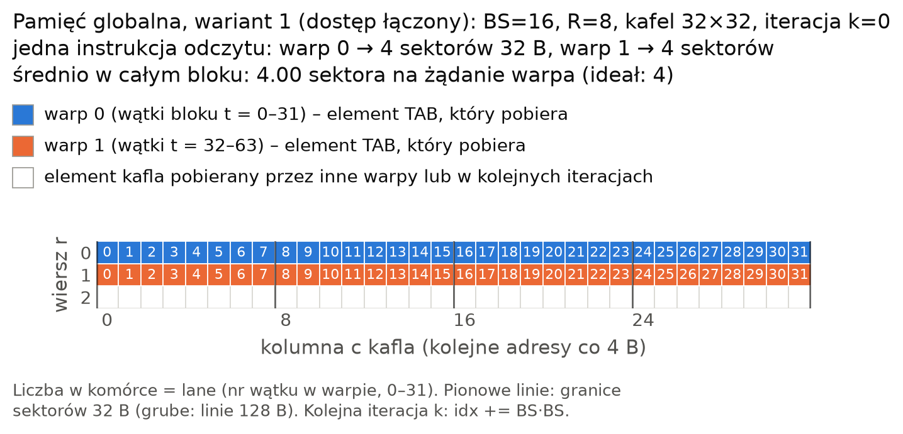
**Rysunek 1.** Wariant 1, odczyt z pamięci globalnej, BS=16, R=8 (kafel 32×32): warp 0 czyta wiersz 0, warp 1 wiersz 1 – po 4 sektory.

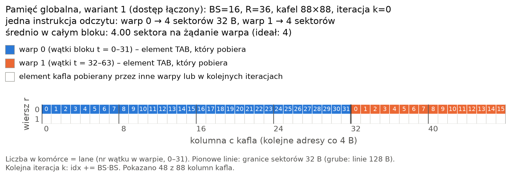
**Rysunek 2.** Wariant 1, odczyt z pamięci globalnej, BS=16, R=36 (kafel 88×88): warpy czytają kolejne fragmenty wiersza 0 – po 4 sektory.

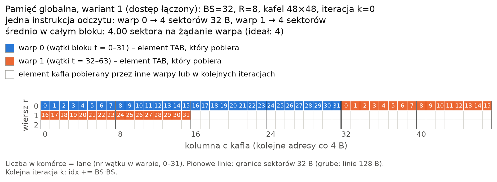
**Rysunek 3.** Wariant 1, odczyt z pamięci globalnej, BS=32, R=8 (kafel 48×48): warp 1 przechodzi przez koniec wiersza 0 i początek wiersza 1.

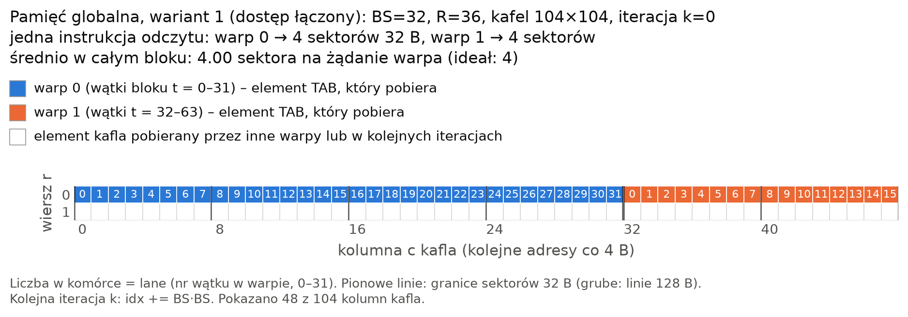
**Rysunek 4.** Wariant 1, odczyt z pamięci globalnej, BS=32, R=36 (kafel 104×104).

**(b) Odczyt z pamięci współdzielonej – bez konfliktów banków.** Wątek czyta słowo `(ty+u)·P + tx+v`.
- **BS=32**: wszystkie 32 wątki warpa mają to samo `ty` i kolejne `tx`, więc czytają 32 kolejne słowa – 32 różne banki,
  dla dowolnego P. Dlatego P = T (bez dopełnienia) – rys. 7, 8.
- **BS=16**: warp to dwa półwiersze (`ty` i `ty+1`, po 16 wątków), przesunięte względem siebie o P słów. Banki
  półwarpów są rozłączne tylko wtedy, gdy P mod 32 = 16. Bez dopełnienia (np. R=8, T=32) oba półwarpy trafiałyby w te same
  banki 0–15 (konflikt 2-krotny). Funkcja `pitchV1` dopełnia więc wiersz do najmniejszego P ≥ T z P mod 32 = 16:
  R=8: P=48 (+16 słów), R=36: P=112 (+24 słowa) – rys. 5, 6.

Kolejne kroki (u, v) przesuwają adresy wszystkich wątków o tę samą wartość, więc rozkład na banki się nie zmienia.
Wynik: **1 przebieg (wavefront) na instrukcję odczytu**, czyli brak konfliktów dla wszystkich konfiguracji.

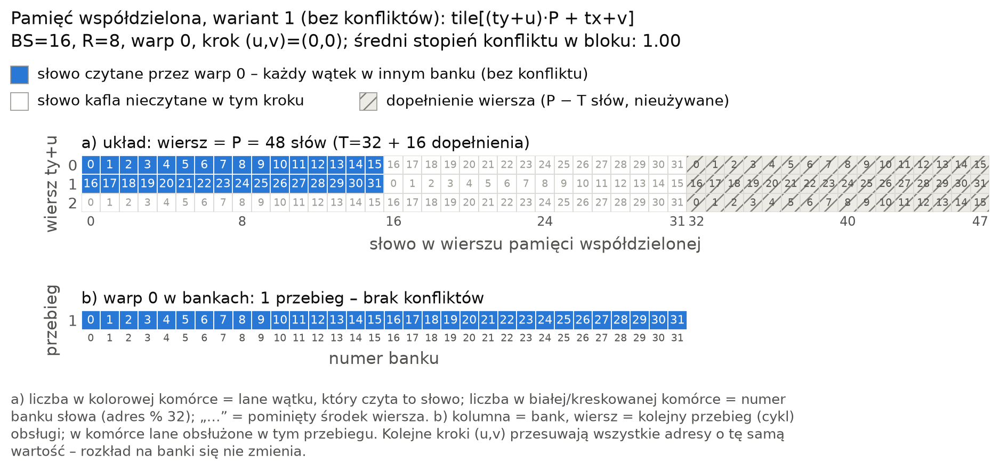
**Rysunek 5.** Wariant 1, pamięć współdzielona, BS=16, R=8, P=48: półwarpy w bankach 0–15 i 16–31 dzięki dopełnieniu wiersza.

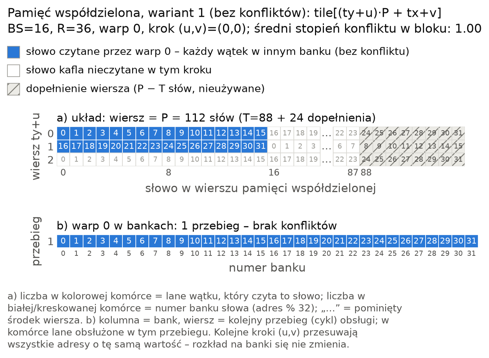
**Rysunek 6.** Wariant 1, pamięć współdzielona, BS=16, R=36, P=112 (T=88 + 24 słowa dopełnienia).

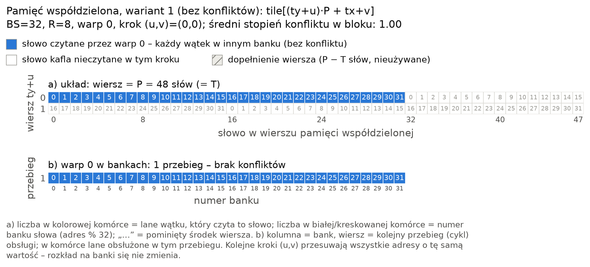
**Rysunek 7.** Wariant 1, pamięć współdzielona, BS=32, R=8, P=T=48: 32 wątki – 32 kolejne banki.

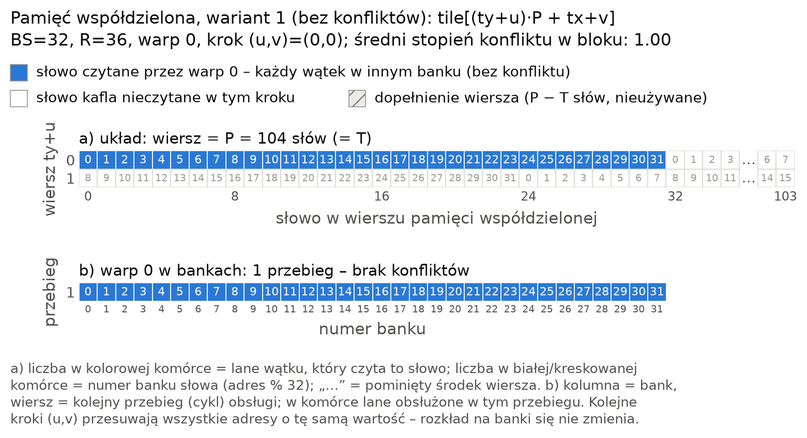
**Rysunek 8.** Wariant 1, pamięć współdzielona, BS=32, R=36, P=T=104.

**Lokalność dostępów:** każdy element TAB jest pobierany z pamięci globalnej przez blok **jeden raz** (lokalność
przestrzenna – łączone odczyty całych linii 128 B), a następnie używany z pamięci współdzielonej do (2R+1)² razy przez
różne wątki bloku (lokalność czasowa realizowana jawnie przez programistę). Sąsiednie bloki pobierają nakładające się
fragmenty „ramki” (halo) szerokości R – te powtórne odczyty mogą trafić w L2. Każdy wynik jest zapisywany raz, łączenie
zapisów jak przy odczytach (kolejne `tx` → kolejne adresy OUT).

### 3.5. Wariant 2 – dostęp nieefektywny

**Listing 4.** Kernel wariantu 2 (`kernels.cuh`) – różnice względem wariantu 1 zaznaczone komentarzami.

```cpp
__host__ __device__ constexpr int pitchV2(int T) {           // P % 32 == 0, jeśli kafel mieści się w 48 KB
    return (T * padTo(T, 0) * 4 <= SMEM_LIMIT) ? padTo(T, 0) : padTo(T, 16);
}

template <int BS>
__global__ void stencilKernelV2(const float *__restrict__ in, float *__restrict__ out, int N, int R) {
    extern __shared__ float tileT[];                     // kafel transponowany: wiersz = kolumna TAB
    const int T = BS + 2 * R;
    const int P = pitchV2(T);
    const int tx = threadIdx.x, ty = threadIdx.y;
    const int i0 = blockIdx.y * BS, j0 = blockIdx.x * BS;

    for (int idx = ty * BS + tx; idx < T * T; idx += BS * BS) {
        const int c = idx / T, r = idx - c * T;          // ZMIANA: kolejne idx -> kolejne WIERSZE TAB
        const int gr = i0 + r, gc = j0 + c;
        tileT[c * P + r] = (gr < N && gc < N) ? in[(size_t)gr * N + gc] : 0.0f;
    }
    __syncthreads();

    const int M = N - 2 * R, K = 2 * R + 1;
    const int i = i0 + ty, j = j0 + tx;
    if (i < M && j < M) {
        const float *base = tileT + tx * P + ty;         // ZMIANA: tx mnożone przez P
        float s = 0.0f;
        for (int u = 0; u < K; ++u)
            for (int v = 0; v < K; ++v) s += base[v * P + u];   // słowo (tx+v)*P + ty+u
        out[(size_t)i * M + j] = s;
    }
}
```

Organizacja zmiennych (pamięć globalna, współdzielona, rejestry), bariera i podział pracy są takie same jak w wariancie 1;
różni się wyłącznie odwzorowanie indeksów na adresy. Wariant liczy ten sam wynik w tej samej kolejności sumowania.

**(a) Odczyt z pamięci globalnej – dostęp niełączony.** Kafel jest przechodzony kolumnami (`r = idx % T`), więc kolejne
wątki warpa czytają ten sam numer kolumny z **kolejnych wierszy TAB**, odległych o N·4 B (16 KB dla N=4096). Każdy wątek
trafia w inny sektor 32 B, z którego wykorzystywane są tylko 4 B: **32 sektory na żądanie warpa** zamiast 4, czyli
8× więcej transakcji i przesłanych danych (rysunki 9–12). Zapis do `tileT[c*P + r]` jest ciągły (kolejne `r`), więc
konflikty dotyczą tylko etapu obliczeń.

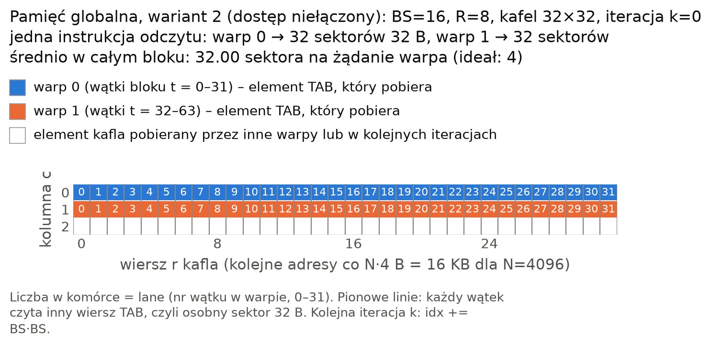
**Rysunek 9.** Wariant 2, odczyt z pamięci globalnej, BS=16, R=8: każdy wątek warpa czyta inny wiersz TAB – 32 sektory na warp.

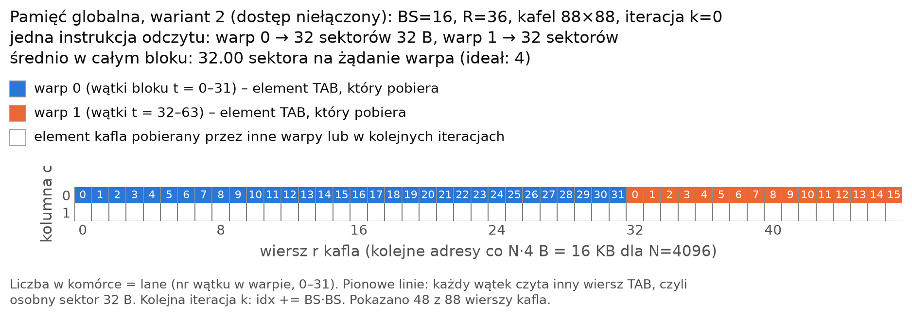
**Rysunek 10.** Wariant 2, odczyt z pamięci globalnej, BS=16, R=36.

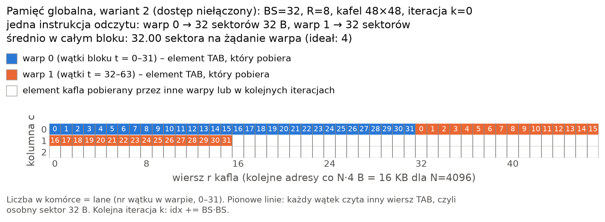
**Rysunek 11.** Wariant 2, odczyt z pamięci globalnej, BS=32, R=8: warp 1 kończy kolumnę 0 (wiersze 32–47) i zaczyna kolumnę 1.

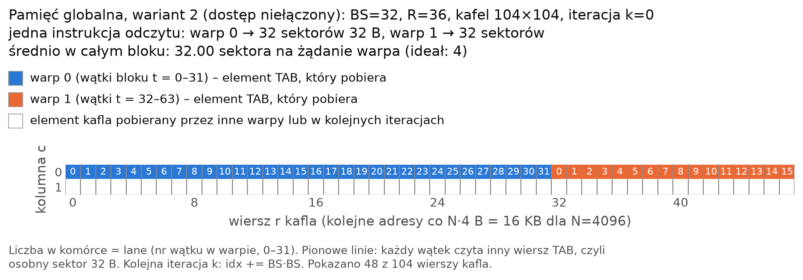
**Rysunek 12.** Wariant 2, odczyt z pamięci globalnej, BS=32, R=36.

**(b) Odczyt z pamięci współdzielonej – konflikty banków.** Wątek czyta słowo `(tx+v)·P + ty+u`, więc sąsiednie wątki
warpa (kolejne `tx`) czytają słowa odległe o **P**. Bank = `((tx+v)·P + ty+u) mod 32`, a liczba wątków trafiających w ten
sam bank (stopień konfliktu) wynosi gcd(P, 32):
- **P mod 32 = 0** (`pitchV2` dopełnia wiersz do wielokrotności 32): wszystkie wątki o tym samym `ty` trafiają w jeden
  bank. BS=32 – warp ma jedno `ty`, więc **konflikt 32-krotny** (32 przebiegi, rys. 15); BS=16 – dwa półwarpy (`ty`,
  `ty+1`) trafiają w dwa sąsiednie banki, po 16 wątków – **konflikt 16-krotny** (rys. 13, 14).
- **BS=32, R=36**: kafel z P=128 wymagałby 104·128·4 = 53 248 B > 48 KB, więc `pitchV2` wybiera P=112 (P mod 32 = 16):
  wątki parzyste trafiają w jeden bank, nieparzyste w drugi – **konflikt 16-krotny** (rys. 16).

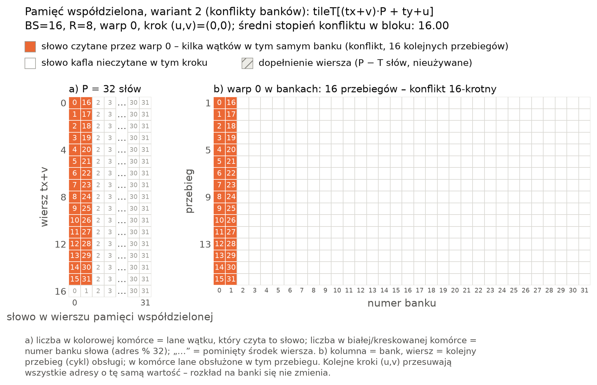
**Rysunek 13.** Wariant 2, pamięć współdzielona, BS=16, R=8, P=32: dwa banki po 16 wątków – 16 przebiegów.

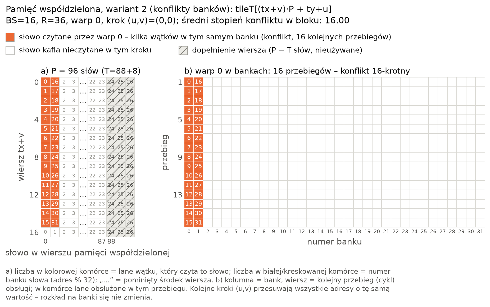
**Rysunek 14.** Wariant 2, pamięć współdzielona, BS=16, R=36, P=96: konflikt 16-krotny.

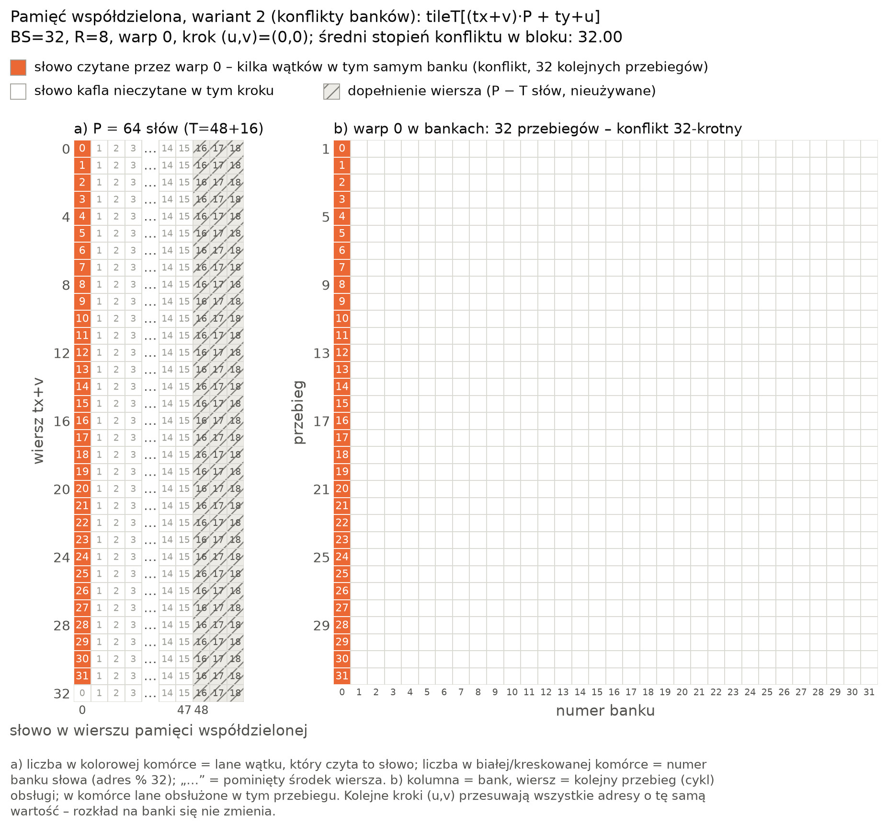
**Rysunek 15.** Wariant 2, pamięć współdzielona, BS=32, R=8, P=64: wszystkie 32 wątki w banku 0 – 32 przebiegi.

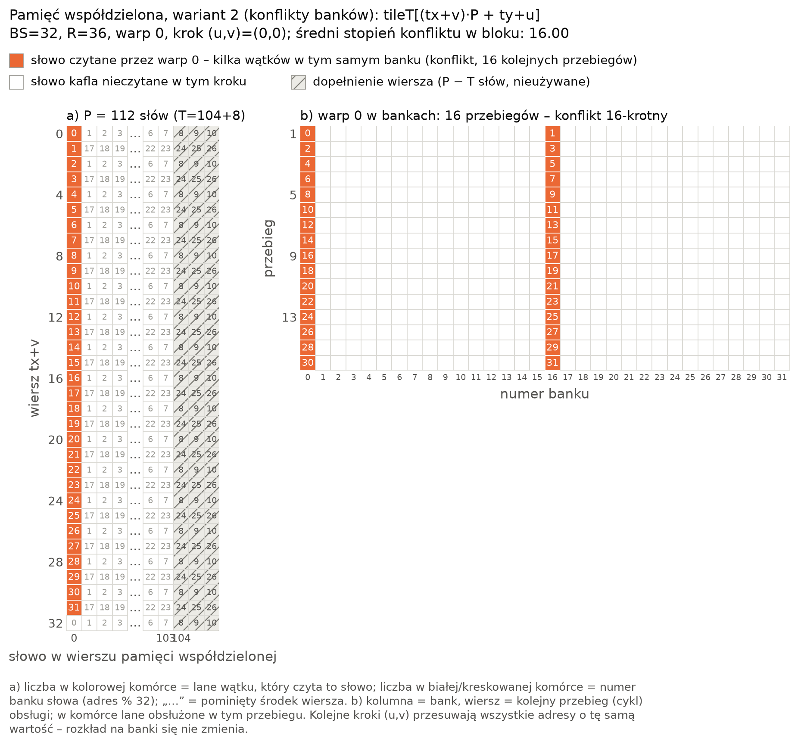
**Rysunek 16.** Wariant 2, pamięć współdzielona, BS=32, R=36, P=112: konflikt 16-krotny (P mod 32 = 16).

**Lokalność:** lokalność czasowa (wielokrotne użycie danych z pamięci współdzielonej) jest taka sama jak w wariancie 1,
natomiast lokalność przestrzenna odczytów globalnych jest zniszczona – z każdego pobranego sektora 32 B wątek używa 4 B,
a pozostałe 28 B mogą zostać wykorzystane dopiero przez inne warpy, jeśli sektor przetrwa w pamięci podręcznej.

**Tabela 4.** Liczba sektorów na żądanie warpa (ładowanie kafla) i średni stopień konfliktu banków (obliczenia) –
wartości wyliczone z indeksowania kerneli (skrypt `figures/access_patterns.py`, cały blok, wszystkie iteracje i kroki u, v).

| BS | R | wariant 1: sektory / żądanie | wariant 2: sektory / żądanie | wariant 1: stopień konfliktu | wariant 2: stopień konfliktu |
|---:|---:|---:|---:|---:|---:|
| 16 | 8  | 4,00 | 32,00 | 1 | 16 |
| 16 | 36 | 4,00 | 32,00 | 1 | 16 |
| 32 | 8  | 4,00 | 32,00 | 1 | 32 |
| 32 | 36 | 4,00 | 32,00 | 1 | 16 |

### 3.6. Test poprawności

- Wyniki GPU są porównywane z CPU **element po elemencie** dla danych niejednorodnych (losowe floaty z [0,1)).
  Tolerancja względna: |GPU − CPU| / max(|CPU|, 1) ≤ (2R+1)²·ε (ε = `FLT_EPSILON`) – oszacowanie błędu sumowania (2R+1)²
  dodatnich składników w innej kolejności.
- Dla danych jednorodnych (same 1,0) każdy element musi wynosić **dokładnie** (2R+1)².
- Przed każdym kernelem tablica wynikowa na GPU jest wypełniana wartościami NaN (`cudaMemset(…, 0xFF, …)`), więc element
  niezapisany przez kernel zostałby wykryty.
- Przetestowano (na obu kartach): BS ∈ {16, 32}, R ∈ {0, 1, 4, 7, 8, 16, 33, 36, 37, 38}, N od 37 do 1031 (w tym M
  niepodzielne przez BS i przez 64), dane losowe i jednorodne, oraz wszystkie konfiguracje eksperymentów (N=4096, 8192).
  **Wszystkie testy zakończyły się zgodnością**; maksymalny błąd względny wyniósł 0 – kernele sumują w tej samej
  kolejności co CPU, więc wyniki są identyczne bitowo.
- `compute-sanitizer --tool memcheck` i `--tool racecheck` (build z `-G`): 0 błędów dostępu, 0 wyścigów w pamięci
  współdzielonej.

### 3.7. Metodyka pomiaru i wzory

**Pomiar czasu.**
- GPU: zdarzenia CUDA (`cudaEventRecord` przed i po kernelu, `cudaEventSynchronize`, `cudaEventElapsedTime`) – mierzony
  jest wyłącznie czas wykonania kernela na GPU, z uwzględnieniem asynchronicznego uruchamiania; transfery CPU↔GPU są poza
  pomiarem.
- CPU: `omp_get_wtime()` wokół funkcji `stencilCPU`.
- **Rozgrzewka** przed pomiarem: kernel (funkcja CPU) jest uruchamiany wielokrotnie przez co najmniej 1 s. RTX 4060 w
  laptopie startuje z zegarem 1890 MHz i podnosi go do ~2475 MHz dopiero po ok. 1 s ciągłego obciążenia (rys. 17, 18);
  bez rozgrzewki krótkie serie (małe N) były mierzone przy niższym zegarze, co dawało fałszywe „schodki” wydajności.
- **Czas reprezentatywny = mediana z 10 pomiarów** (odporna na pojedyncze zakłócenia, np. procesy w tle); zapisywane są też
  minimum i średnia (`results/*.csv`).
- Pomiary laptopa wykonano przy zasilaniu sieciowym w trybie „Performance” (limit mocy GPU 105 W).

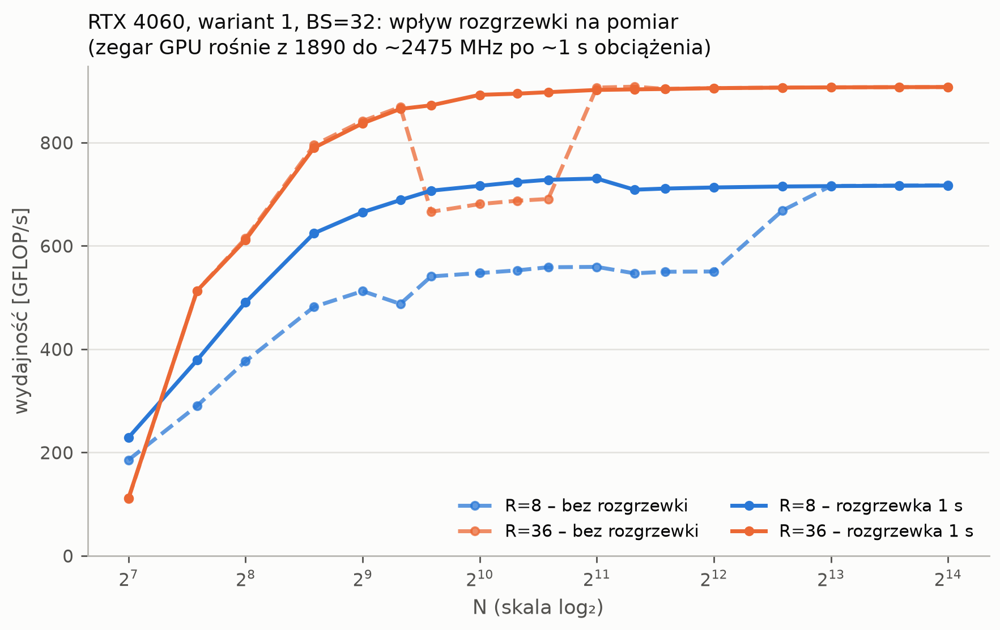
**Rysunek 17.** Wpływ rozgrzewki na pomiar wydajności wariantu 1 (RTX 4060, BS=32): linie przerywane – bez rozgrzewki, ciągłe – rozgrzewka 1 s.

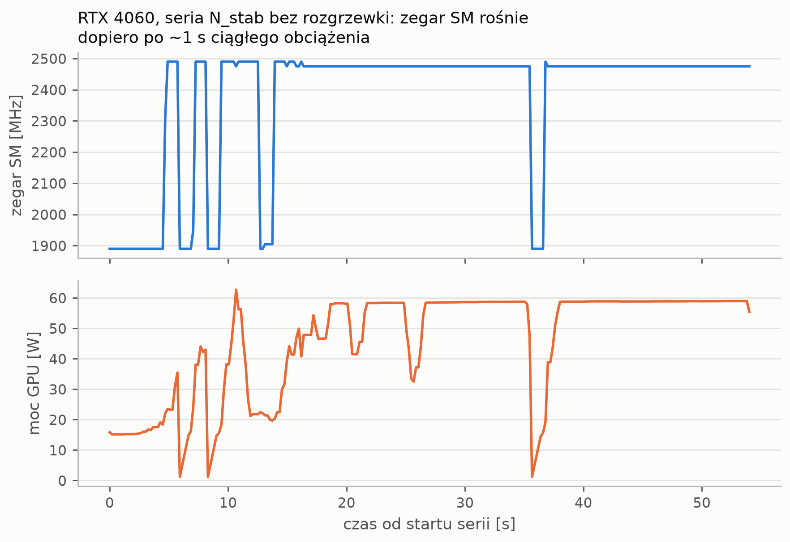
**Rysunek 18.** Zegar SM i moc RTX 4060 podczas serii pomiarów bez rozgrzewki – zegar wzrasta dopiero po ok. 1 s obciążenia.

**Wzory.** K = 2R+1, M = N − 2R, T = BS + 2R, t – czas obliczeń [s].

- Liczba operacji (tylko dodawania na danych, bez adresowania i sterowania):
  **FLOP = M² · (K² − 1)** – każdy z M² wyników jest sumą K² składników, czyli K² − 1 dodawań.
- Wydajność: **W = FLOP / t** [FLOP/s].
- Szacunkowa energia: **E = P_nom · t** [J], P_nom – moc nominalna układu (tabele 1, 2): i7-8700 65 W, Ryzen 7 7840HS 54 W,
  GTX 1080 180 W, RTX 4060 Laptop 105 W. Efektywność energetyczna: **FLOP / E = W / P_nom** [FLOP/J].
- Teoretyczny **CGMA** (liczba operacji / liczba dostępów do pamięci globalnej w kodzie źródłowym; odczyty + zapisy):
  - kernel bez pamięci współdzielonej: każdy wątek K² odczytów i 1 zapis na K² − 1 dodawań → **CGMA = (K²−1)/(K²+1) ≈ 1**;
  - warianty 1 i 2: blok wykonuje T² odczytów (każdy element kafla raz) i BS² zapisów na BS²·(K²−1) dodawań →
    **CGMA = BS²·(K²−1) / (T² + BS²)**.

**Tabela 5.** Teoretyczny CGMA.

| R | BS | T | kernel bez pamięci współdzielonej | warianty 1 i 2 |
|---:|---:|---:|---:|---:|
| 8  | 16 | 32  | 0,99 | 57,6 |
| 8  | 32 | 48  | 0,99 | 88,6 |
| 36 | 16 | 88  | 1,00 | 170,5 |
| 36 | 32 | 104 | 1,00 | 460,8 |

CGMA rośnie z BS i R: większy blok to relatywnie mniejsza ramka (T²/BS² maleje), a większe R to więcej obliczeń na każdy
pobrany element. Wariant 2 ma **ten sam** CGMA co wariant 1 (ta sama liczba dostępów w kodzie) – różni się ich sposobem,
co CGMA nie uwzględnia (rzeczywista liczba przesłanych sektorów jest 8× większa, tab. 4).

---

## 4. Wyniki pomiarów

### 4.1. Wyznaczenie N_stab

Wariant 1 (efektywny), BS=32, R1=8 i R2=36, N = 128…16384. N_stab = najmniejsze N z serii, dla którego żadne większe N
nie daje wydajności większej o więcej niż 5%.

**Tabela 6.** Seria N_stab dla **R1 = 8** (wariant 1, BS=32; czas = mediana 10 pomiarów; „bloki” = liczba bloków siatki).

| N | M = N−2R | bloki | GTX 1080 t [ms] | GTX 1080 GFLOP/s | % maks. | RTX 4060 t [ms] | RTX 4060 GFLOP/s | % maks. |
|---:|---:|---:|---:|---:|---:|---:|---:|---:|
| 128 | 112 | 16 | 0,0099 | 366 | 44 | 0,0158 | 229 | 31 |
| 192 | 176 | 36 | 0,0163 | 547 | 65 | 0,0236 | 379 | 52 |
| 256 | 240 | 64 | 0,0276 | 601 | 72 | 0,0338 | 491 | 67 |
| 384 | 368 | 144 | 0,0543 | 719 | 86 | 0,0624 | 625 | 86 |
| 512 | 496 | 256 | 0,0901 | 787 | 94 | 0,1065 | 665 | 91 |
| 640 | 624 | 400 | 0,1402 | **800 (N_stab)** | 96 | 0,1628 | 689 | 94 |
| 768 | 752 | 576 | 0,2038 | 799 | 96 | 0,2304 | **707 (N_stab)** | 97 |
| 1024 | 1008 | 1024 | 0,3712 | 788 | 94 | 0,4085 | 716 | 98 |
| 1280 | 1264 | 1600 | 0,5608 | 821 | 98 | 0,6359 | 724 | 99 |
| 1536 | 1520 | 2304 | 0,8038 | 828 | 99 | 0,9139 | 728 | 100 |
| 2048 | 2032 | 4096 | 1,4317 | 831 | 99 | 1,6282 | 730 | 100 |
| 2560 | 2544 | 6400 | 2,2712 | 821 | 98 | 2,6296 | 709 | 97 |
| 3072 | 3056 | 9216 | 3,2990 | 815 | 97 | 3,7827 | 711 | 97 |
| 4096 | 4080 | 16384 | 5,7503 | 834 | 100 | 6,7220 | 713 | 98 |
| 6144 | 6128 | 36864 | 13,1055 | 825 | 99 | 15,1245 | 715 | 98 |
| 8192 | 8176 | 65536 | 23,0214 | 836 | 100 | 26,8948 | 716 | 98 |
| 12288 | 12272 | 147456 | 51,8613 | 836 | 100 | 60,5332 | 717 | 98 |
| 16384 | 16368 | 262144 | 92,4436 | 835 | 100 | 107,6311 | 717 | 98 |

**Tabela 7.** Seria N_stab dla **R2 = 36** (wariant 1, BS=32).

| N | M = N−2R | bloki | GTX 1080 t [ms] | GTX 1080 GFLOP/s | % maks. | RTX 4060 t [ms] | RTX 4060 GFLOP/s | % maks. |
|---:|---:|---:|---:|---:|---:|---:|---:|---:|
| 128 | 56 | 4 | 0,1023 | 163 | 15 | 0,1495 | 112 | 12 |
| 192 | 120 | 16 | 0,1034 | 742 | 68 | 0,1495 | 513 | 57 |
| 256 | 184 | 36 | 0,2036 | 886 | 81 | 0,2949 | 612 | 67 |
| 384 | 312 | 100 | 0,4991 | 1039 | 95 | 0,6564 | 790 | 87 |
| 512 | 440 | 196 | 0,9874 | **1045 (N_stab)** | 96 | 1,2319 | 837 | 92 |
| 640 | 568 | 324 | 1,6474 | 1043 | 96 | 1,9866 | **865 (N_stab)** | 95 |
| 768 | 696 | 484 | 2,4499 | 1053 | 96 | 2,9594 | 872 | 96 |
| 1024 | 952 | 900 | 4,5250 | 1067 | 98 | 5,4103 | 893 | 98 |
| 1280 | 1208 | 1444 | 7,2197 | 1077 | 99 | 8,6892 | 895 | 99 |
| 1536 | 1464 | 2116 | 10,5512 | 1082 | 99 | 12,7212 | 898 | 99 |
| 2048 | 1976 | 3844 | 19,1422 | 1087 | 100 | 23,0640 | 902 | 99 |
| 2560 | 2488 | 6084 | 30,3032 | 1088 | 100 | 36,5210 | 903 | 100 |
| 3072 | 3000 | 8836 | 43,9982 | 1090 | 100 | 53,0545 | 904 | 100 |
| 4096 | 4024 | 15876 | 79,0192 | 1092 | 100 | 95,2847 | 905 | 100 |
| 6144 | 6072 | 36100 | 179,8587 | 1092 | 100 | 216,6972 | 907 | 100 |
| 8192 | 8120 | 64516 | 322,8195 | 1088 | 100 | 387,3449 | 907 | 100 |
| 12288 | 12216 | 145924 | 734,1962 | 1083 | 99 | 876,2552 | 907 | 100 |
| 16384 | 16312 | 260100 | 1311,1597 | 1081 | 99 | 1562,0428 | 908 | 100 |

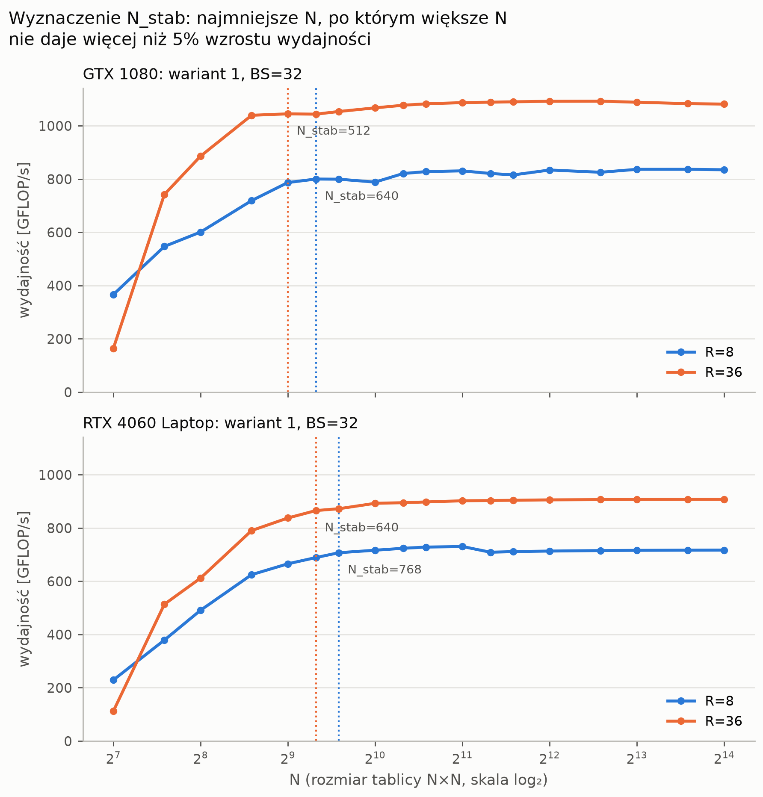
**Rysunek 19.** Wydajność wariantu 1 (BS=32) w funkcji N dla R=8 i R=36 na obu kartach, z zaznaczonym N_stab.

**Tabela 8.** Wyznaczone wartości N_stab (próg 5%).

| | R1 = 8 | R2 = 36 |
|---|---:|---:|
| GTX 1080 | 640 | 512 |
| RTX 4060 Laptop | 768 | 640 |

Maksimum z wyznaczonych wartości wynosi **768**, dlatego główny eksperyment wykonano dla N = 4096 i 8192.

### 4.2. Porównanie CPU i wariantów GPU

**Tabela 9.** GTX 1080 i CPU i7-8700 (12 wątków): czas (mediana 10 pomiarów) i wydajność.

| N | R | BS | CPU t [ms] | CPU GFLOP/s | wariant 1 t [ms] | wariant 1 GFLOP/s | wariant 2 t [ms] | wariant 2 GFLOP/s | w1 / CPU | w1 / w2 |
|---:|---:|---:|---:|---:|---:|---:|---:|---:|---:|---:|
| 4096 | 8 | 16 | 23,0 | 209 | 5,57 | 861 | 63,6 | 75 | 4,1× | 11,4× |
| 4096 | 8 | 32 | 22,9 | 209 | 5,91 | 811 | 127,2 | 38 | 3,9× | 21,5× |
| 4096 | 36 | 16 | 352,2 | 245 | 85,82 | 1005 | 1148,9 | 75 | 4,1× | 13,4× |
| 4096 | 36 | 32 | 353,1 | 244 | 77,81 | 1109 | 1147,0 | 75 | 4,5× | 14,7× |
| 8192 | 8 | 16 | 96,0 | 201 | 22,73 | 847 | 258,8 | 74 | 4,2× | 11,4× |
| 8192 | 8 | 32 | 95,7 | 201 | 23,33 | 825 | 517,6 | 37 | 4,1× | 22,2× |
| 8192 | 36 | 16 | 1439,7 | 244 | 364,37 | 964 | 4735,0 | 74 | 4,0× | 13,0× |
| 8192 | 36 | 32 | 1442,0 | 244 | 320,94 | 1095 | 4703,6 | 75 | 4,5× | 14,7× |

**Tabela 10.** RTX 4060 Laptop i CPU Ryzen 7 7840HS (16 wątków): czas (mediana 10 pomiarów) i wydajność.

| N | R | BS | CPU t [ms] | CPU GFLOP/s | wariant 1 t [ms] | wariant 1 GFLOP/s | wariant 2 t [ms] | wariant 2 GFLOP/s | w1 / CPU | w1 / w2 |
|---:|---:|---:|---:|---:|---:|---:|---:|---:|---:|---:|
| 4096 | 8 | 16 | 28,8 | 166 | 5,89 | 814 | 41,8 | 115 | 4,9× | 7,1× |
| 4096 | 8 | 32 | 27,9 | 172 | 6,72 | 713 | 82,2 | 58 | 4,1× | 12,2× |
| 4096 | 36 | 16 | 538,0 | 160 | 94,68 | 911 | 734,7 | 117 | 5,7× | 7,8× |
| 4096 | 36 | 32 | 566,4 | 152 | 95,29 | 905 | 730,2 | 118 | 5,9× | 7,7× |
| 8192 | 8 | 16 | 120,9 | 159 | 23,63 | 815 | 167,6 | 115 | 5,1× | 7,1× |
| 8192 | 8 | 32 | 118,9 | 162 | 26,90 | 716 | 330,0 | 58 | 4,4× | 12,3× |
| 8192 | 36 | 16 | 2242,7 | 157 | 385,00 | 912 | 2991,1 | 117 | 5,8× | 7,8× |
| 8192 | 36 | 32 | 2224,4 | 158 | 387,35 | 907 | 2971,7 | 118 | 5,7× | 7,7× |

CPU nie zależy od BS – jest mierzony przy każdym BS osobno (dla porównania element po elemencie), stąd dwa pomiary CPU dla
każdej pary (N, R).

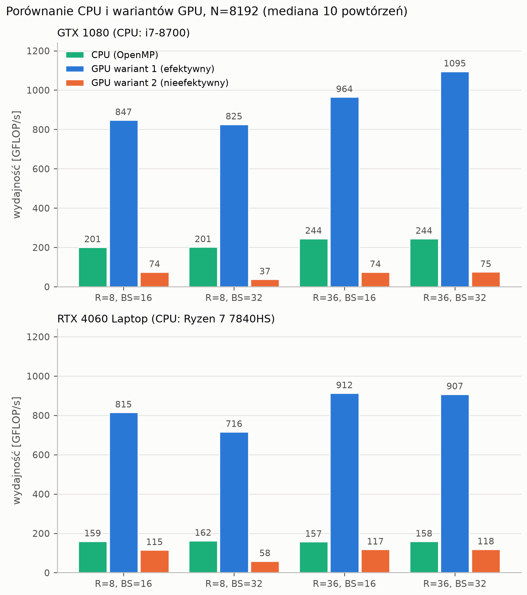
**Rysunek 20.** Wydajność CPU, wariantu 1 i wariantu 2 dla N=8192 na obu systemach.

### 4.3. Energia

**Tabela 11.** Szacunkowa energia E = P_nom · t i efektywność energetyczna dla N=8192 (wyniki dla N=4096 – `results/energia_cgma.md`).

| system | R | BS | E CPU [J] | E wariant 1 [J] | E wariant 2 [J] | CPU [GFLOP/J] | wariant 1 [GFLOP/J] | wariant 2 [GFLOP/J] | E CPU / E w1 |
|---|---:|---:|---:|---:|---:|---:|---:|---:|---:|
| GTX 1080 + i7-8700 | 8 | 16 | 6,24 | 4,09 | 46,58 | 3,09 | 4,71 | 0,41 | 1,52× |
| GTX 1080 + i7-8700 | 8 | 32 | 6,22 | 4,20 | 93,16 | 3,09 | 4,58 | 0,21 | 1,48× |
| GTX 1080 + i7-8700 | 36 | 16 | 93,58 | 65,59 | 852,30 | 3,75 | 5,36 | 0,41 | 1,43× |
| GTX 1080 + i7-8700 | 36 | 32 | 93,73 | 57,77 | 846,65 | 3,75 | 6,08 | 0,41 | 1,62× |
| RTX 4060 + Ryzen 7 7840HS | 8 | 16 | 6,53 | 2,48 | 17,60 | 2,95 | 7,76 | 1,09 | 2,63× |
| RTX 4060 + Ryzen 7 7840HS | 8 | 32 | 6,42 | 2,82 | 34,65 | 3,00 | 6,82 | 0,56 | 2,27× |
| RTX 4060 + Ryzen 7 7840HS | 36 | 16 | 121,11 | 40,42 | 314,06 | 2,90 | 8,69 | 1,12 | 3,00× |
| RTX 4060 + Ryzen 7 7840HS | 36 | 32 | 120,12 | 40,67 | 312,03 | 2,92 | 8,64 | 1,13 | 2,95× |

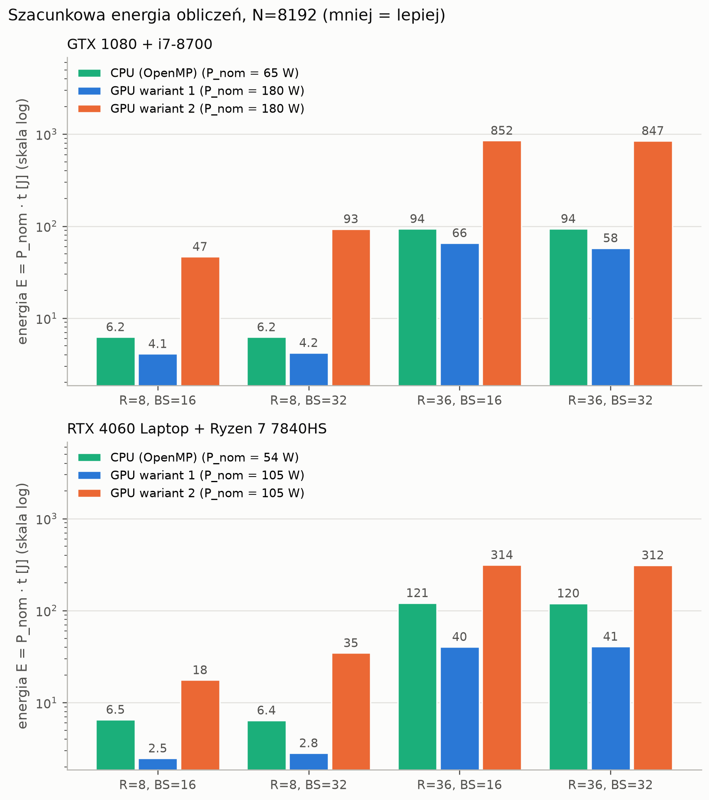
**Rysunek 21.** Szacunkowa energia obliczeń dla N=8192 (skala logarytmiczna; mniej = lepiej).

Rzeczywisty pobór mocy zmierzony `nvidia-smi` w czasie pomiarów: GTX 1080 średnio ~172 W (na limicie 180 W, zegar
~1830 MHz), RTX 4060 ~37–76 W (wyraźnie poniżej limitu 105 W). Oszacowanie z mocy nominalnej jest więc bliskie
rzeczywistości dla GTX 1080, a dla RTX 4060 zawyża energię GPU (rzeczywista efektywność energetyczna laptopowej karty
jest wyższa niż w tabeli 11).

### 4.4. Potwierdzenie profilerem (Nsight Compute)

Liczbę transakcji pamięci globalnej i konfliktów banków zmierzono na RTX 4060 narzędziem `ncu` (N=1024, metryki
`l1tex__t_sectors_pipe_lsu_mem_global_op_ld`, `l1tex__t_requests_pipe_lsu_mem_global_op_ld`,
`l1tex__data_pipe_lsu_wavefronts_mem_shared_op_ld`, `smsp__inst_executed_op_shared_ld`; dane: `results/ncu_rtx4060.csv`).
Pomiar wykonano dla R=4 i R=36 (przed ostatecznym wyborem R1=8); model z tabeli 4 daje dla R=4 te same wartości co dla R=8,
z wyjątkiem BS=16, R=4 w wariancie 2 (kafel ma tylko T=24 wiersze, więc część warpa przechodzi do następnej kolumny).

**Tabela 12.** Wyniki `ncu`: sektory 32 B na żądanie odczytu globalnego i przebiegi (wavefronts) na instrukcję odczytu
z pamięci współdzielonej.

| BS | R | wariant 1: sektory / żądanie | wariant 2: sektory / żądanie | wariant 1: przebiegi / odczyt | wariant 2: przebiegi / odczyt |
|---:|---:|---:|---:|---:|---:|
| 16 | 4  | 3,98 | 23,9 | ≈1 (0 konfliktów) | 15,9 |
| 16 | 36 | 3,99 | 32,0 | ≈1 (0,01% konfliktów) | 15,9 |
| 32 | 4  | 3,98 | 31,8 | ≈1 | 31,8 |
| 32 | 36 | 3,99 | 31,9 | ≈1 (0 konfliktów) | 15,9 |

Pomiary profilera potwierdzają analizę z rozdziału 3 (rysunki 1–16, tabela 4): wariant 1 – 4 sektory na żądanie i brak
konfliktów, wariant 2 – ~32 sektory na żądanie i konflikty 16- lub 32-krotne.

---

## 5. Wnioski

**1. Wariant 1 jest ograniczony przepustowością pamięci współdzielonej.** W wariancie 1 każde dodawanie wymaga jednego
odczytu z pamięci współdzielonej (`s += base[...]`), a SM obsługuje co najwyżej 32 słowa (jeden warp bez konfliktów) na
takt. Górne ograniczenie wydajności to więc ok. liczba SM × 32 × zegar:
- GTX 1080: 20 × 32 × 1,83 GHz ≈ 1170 GFLOP/s – zmierzono **1095 GFLOP/s (94%)** dla BS=32, R=36;
- RTX 4060: 24 × 32 × 2,475 GHz ≈ 1900 GFLOP/s – zmierzono **~910 GFLOP/s (48%)**.

Szczytowa wydajność samych dodawań (bez FMA) to ok. 4,7 TFLOP/s (GTX 1080) i 7,6 TFLOP/s (RTX 4060), więc kernel nie jest
ograniczony przez jednostki arytmetyczne ani przez pamięć globalną (CGMA 58–461, potrzebna przepustowość pamięci globalnej
W / CGMA · 4 B to ok. 10–60 GB/s z dostępnych 256–320 GB/s). Na RTX 4060 blok 32×32 (1024 wątki) pozwala uruchomić tylko 1 blok na
SM (limit 1536 wątków), a bariera `__syncthreads()` i faza ładowania nie są przykrywane pracą innego bloku – to
prawdopodobna przyczyna niższego wykorzystania niż na GTX 1080, gdzie mieszczą się 2 bloki na SM.

**2. Spowolnienie wariantu 2 wynika przede wszystkim z konfliktów banków.** Przy konflikcie k-krotnym odczyt warpa trwa
k przebiegów, więc z modelu z punktu 1 wydajność powinna spaść k razy. Zgodność z pomiarem jest bardzo dobra:

| | konflikt | przewidywanie [GFLOP/s] | pomiar [GFLOP/s] |
|---|---:|---:|---:|
| GTX 1080, BS=16 lub R=36 | 16 | 1170 / 16 ≈ 73 | 74–75 |
| GTX 1080, BS=32, R=8 | 32 | 1170 / 32 ≈ 37 | 37–38 |
| RTX 4060, BS=16 lub R=36 | 16 | 1900 / 16 ≈ 119 | 115–118 |
| RTX 4060, BS=32, R=8 | 32 | 1900 / 32 ≈ 59 | 58 |

Dlatego wariant 2 przy BS=32, R=8 jest dwukrotnie wolniejszy niż przy BS=16 (konflikt 32- zamiast 16-krotnego), a przy
R=36 oba rozmiary bloku dają tę samą wydajność (konflikt 16-krotny w obu przypadkach – przy BS=32 wymusza go limit 48 KB).
Niełączone odczyty globalne (8× więcej sektorów) mają tu mały wpływ, bo faza ładowania stanowi niewielką część pracy
(wysoki CGMA); bardziej obciążają przepustowość pamięci i energię, ale nie są wąskim gardłem.

**3. Rozmiar bloku BS.**
- Przy R=36 na GTX 1080 BS=32 jest wyraźnie lepszy (1095 vs 964 GFLOP/s): mniejszy narzut ramki (CGMA 461 vs 171) i więcej
  aktywnych wątków na SM (2 bloki × 1024 = 2048, przy BS=16 pamięć współdzielona pozwala tylko na 2 bloki × 256 = 512
  wątków).
- Przy R=8 lepszy jest BS=16 (GTX 1080: 861 vs 811, RTX 4060: 815 vs 716): małe kafle pozwalają uruchomić wiele bloków na
  SM (8 na GTX 1080, 6 na RTX 4060), które wzajemnie przykrywają fazy ładowania i bariery; przy BS=32 na RTX 4060 działa
  tylko 1 blok na SM.
- W wariancie 2 o wpływie BS decyduje stopień konfliktu (punkt 2), a nie obsadzenie SM.

**4. Wpływ R i N.**
- Większe R zwiększa CGMA i udział obliczeń, więc wariant 1 osiąga wyższą wydajność (GTX 1080: 825–861 → 964–1109
  GFLOP/s), a czas rośnie ~K²-krotnie (FLOP ∝ (2R+1)²).
- N_stab wynosi 512–768: wydajność stabilizuje się, gdy liczba bloków wielokrotnie przekracza liczbę bloków aktywnych
  jednocześnie (GTX 1080: 20 SM × 2 = 40, RTX 4060: 24 × 1 = 24). Dla małych N część SM jest bezczynna, a ostatnia „fala”
  bloków jest niepełna (dla R=36 i N=128 oraz N=192 czas jest identyczny – 4 i 16 bloków mieści się w jednej fali).
  Dla R=36 N_stab jest mniejsze niż dla R=8, bo każdy blok wykonuje dużo pracy, a koszt uruchomienia kernela jest
  relatywnie mniejszy.
- Dla dużych N (> 2048) wydajność nie zależy od N – kernel ma stały koszt na blok, a dane (do 1 GB) nie mieszczą się
  w pamięciach podręcznych, co nie ma znaczenia przy wysokim CGMA.

**5. CPU a GPU.** Wariant 1 jest 4–6× szybszy od wektoryzowanej (AVX2) wersji OpenMP wykorzystującej wszystkie wątki CPU.
CPU osiąga 150–245 GFLOP/s: każdy rdzeń wykonuje 8 dodawań na instrukcję AVX2, ale także ogranicza go przepustowość
odczytów (jeden odczyt na dodawanie, jak na GPU). i7-8700 mimo mniejszej liczby rdzeni jest szybszy od Ryzena w laptopie –
prawdopodobnie dzięki wyższemu limitowi mocy procesora stacjonarnego (65 W wobec 35–54 W) i innej optymalizacji pętli
przez gcc niż przez MSVC. Wariant 2 jest **wolniejszy od CPU we wszystkich konfiguracjach** (GTX 1080: 37–75 wobec
201–245 GFLOP/s, RTX 4060: 58–118 wobec 152–172 GFLOP/s) – źle zorganizowany dostęp do pamięci całkowicie niweluje
przewagę GPU.

**6. Energia.** GPU z wariantem 1 zużywa mniej energii niż CPU, mimo ok. 2–3× większej mocy nominalnej, bo liczy 4–6× krócej:
GTX 1080 1,4–1,6× mniej energii niż i7-8700, RTX 4060 2,3–3,0× mniej niż Ryzen 7 7840HS (6,8–8,7 GFLOP/J wobec 2,9–3,0).
Laptopowa karta jest najefektywniejsza energetycznie, bo ma niską moc i nowszą architekturę (proces technologiczny
4 nm wobec 16 nm Pascala). Wariant 2 zużywa 7–22× więcej energii niż wariant 1 i 3–15× więcej niż CPU – nieefektywny dostęp
do pamięci kosztuje nie tylko czas, ale wprost energię (moc jest pobierana przez cały, wydłużony czas obliczeń).
Wartości energii są oszacowaniem (moc nominalna × czas); zmierzony pobór RTX 4060 (37–76 W) był niższy niż 105 W.

**7. Podsumowanie.** O wydajności tego zadania na GPU decyduje organizacja dostępu do pamięci, a nie moc obliczeniowa:
ten sam algorytm z tą samą liczbą operacji i dostępów (ten sam CGMA) działa 7–22× wolniej przy niełączonych odczytach
globalnych i konfliktach banków. Kluczowe techniki to: kolektywne ładowanie kafla z kolejnymi wątkami na kolejnych
adresach (łączenie dostępów), indeksowanie pamięci współdzielonej tak, by kolejne wątki warpa czytały kolejne słowa,
dopełnienie wiersza dla BS=16 (P mod 32 = 16) oraz dobór BS do R i limitów CC (wątki i pamięć współdzielona na SM).
